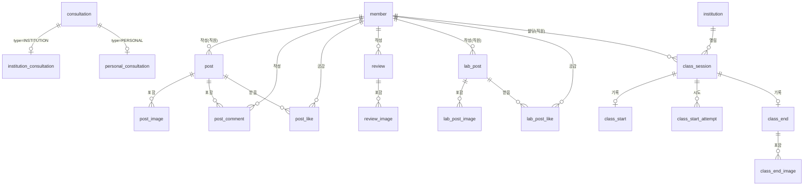

# DB 스키마

> 기준: [docs/requirements/requirement_homepage.md](../../docs/requirements/requirement_homepage.md) (2026-10-14 시점, FR-001~023).
> 네이밍·JPA 규칙은 [database.md](database.md)를 따른다. Entity는 `com.mongkids.domain.{member,consultation,post,review,attendance}.entity`에 있고, 스키마를 바꾸면 이 문서를 함께 갱신한다.

## 1. 공통 규칙

- PK: `id BIGINT AUTO_INCREMENT` (`@GeneratedValue(strategy = IDENTITY)`).
- 모든 테이블에 `created_at`, `updated_at` (`DATETIME(6)`, `BaseTimeEntity`). 아래 컬럼 표에서는 생략한다.
- enum은 `VARCHAR` + `@Enumerated(EnumType.STRING)`. DB enum 타입은 쓰지 않는다.
  - Hibernate 7은 enum 필드를 MariaDB 네이티브 `enum(...)`(H2는 CHECK 제약)으로 만들어 값 추가 때마다 DDL 변경이 필요하다. 그래서 `@Column(columnDefinition = "varchar(n)")`을 명시한다.
  - 같은 이유로 상속 판별 컬럼(`@DiscriminatorColumn`)도 쓰지 않는다 (`consultation.type` 참고).
- boolean은 Hibernate MariaDB 기본 매핑인 `BIT(1)`로 생성된다.
- 이미지·파일은 S3에 저장하고 DB에는 **객체 키**만 둔다 (`image_key`). URL은 CloudFront 도메인과 조합해 응답에서 만든다.
- 삭제 정책: 회원·게시물·댓글·후기는 soft delete(`deleted_at`). 공감, 이미지 행은 hard delete.
- 개수 제한(사진 20장, 10MB 등)은 DB 제약이 아니라 Service 검증으로 처리한다.

## 2. ERD

| 도메인 | 테이블 | 요구사항 |
|---|---|---|
| member | `member` | FR-018, FR-019, FR-022 |
| consultation | `consultation`, `institution_consultation`, `personal_consultation` | FR-001~004, FR-023 |
| post | `post`, `post_image`, `post_comment`, `post_like` (수업 현장), `lab_post`, `lab_post_image`, `lab_post_like` (몽키즈 연구소) | FR-008~012 |
| review | `review`, `review_image` | FR-012~017, FR-021 |
| attendance | `institution`, `class_session`, `class_start`, `class_start_attempt`, `class_end`, `class_end_image` (근태 관리) | EMP-FR-001~004, 010~014 |

## 3. 테이블 정의

### member — 회원 (FR-018, FR-019, FR-022, FR-028)

| 컬럼 | 타입 | 제약 | 설명 |
|---|---|---|---|
| id | BIGINT | PK | |
| provider | VARCHAR(10) | NOT NULL | `KAKAO`, `NAVER` |
| provider_id | VARCHAR(100) | NULL | 소셜 서비스의 사용자 식별자. 탈퇴하면 NULL |
| name | VARCHAR(50) | NOT NULL | 소셜 프로필 이름(닉네임). 후기 마스킹 표시 대상(FR-014) |
| email | VARCHAR(255) | NULL | 소셜에서 제공될 때만 |
| phone | VARCHAR(20) | NULL | 가입 정보 입력(FR-019) 전에는 NULL |
| sns_agreed | BIT(1) | NOT NULL, 기본 false | SNS 수신 동의 |
| sns_agreed_at | DATETIME(6) | NULL | 동의 시각 (동의 철회 시 NULL) |
| role | VARCHAR(10) | NOT NULL, 기본 `MEMBER` | `MEMBER`, `STAFF`, `ADMIN` |
| deleted_at | DATETIME(6) | NULL | 탈퇴 시각 |

- UNIQUE (`provider`, `provider_id`). NULL은 여러 행이 가질 수 있어 탈퇴 회원이 쌓여도 충돌하지 않는다.
- 기관/개인 회원 타입은 두지 않는다 (FR-020 폐기).
- 직원 권한 부여·회수(FR-022)는 `role`을 `MEMBER` ↔ `STAFF`로 바꾼다. `ADMIN`은 운영 DB에서 직접 지정한다.
- 탈퇴(FR-028) 시 `deleted_at`을 기록하고 개인정보를 바로 지운다: `name` = "탈퇴 회원", `provider_id`·`email`·`phone`·`sns_agreed_at` = NULL, `sns_agreed` = false. 행은 남겨 작성한 후기·게시물·댓글·공감을 유지하고 작성자를 "탈퇴 회원"으로 표시한다. 같은 소셜 계정으로 다시 로그인하면 새 행으로 가입된다.
- 운영 DDL: [sql/member-withdraw-ddl.sql](sql/member-withdraw-ddl.sql) (`provider_id` NULL 허용).

### consultation — 상담 신청 공통 (FR-003, FR-004, FR-023, FR-026)

기관·개인 폼의 항목이 크게 달라 JPA `@Inheritance(strategy = JOINED)`로 나눈다. 관리자 목록 조회(FR-004)는 부모 테이블 하나로 처리한다.

| 컬럼 | 타입 | 제약 | 설명 |
|---|---|---|---|
| id | BIGINT | PK | |
| type | VARCHAR(20) | NOT NULL | `INSTITUTION`, `PERSONAL` (일반 컬럼, 생성 후 변경 불가) |
| phone | VARCHAR(20) | NOT NULL | 연락받을 전화번호 (두 폼 공통, 숫자만. 기관은 유선번호 허용, 개인은 010 휴대전화만) |
| status | VARCHAR(20) | NOT NULL, 기본 `RECEIVED` | 처리 상태(FR-026): `RECEIVED`(신규), `CONTACTED`(연락 완료), `COMPLETED`(상담 완료) |
| privacy_agreed_at | DATETIME(6) | NOT NULL | 개인정보 수집 동의 시각 (필수) |
| completed_at | DATETIME(6) | NULL | 상담 완료로 바꾼 시각. 다른 상태로 되돌리면 NULL (2026-10-24 추가) |

- INDEX (`status`, `created_at`) — 관리자 목록 필터
- 비회원 신청(FR-003)이므로 `member` FK를 두지 않는다.
- 보관 기간(FR-023, 상담 완료 후 3년)이 지나면 행을 삭제하는 배치가 필요하다 (`completed_at` 기준, 미구현).
- 운영 DB(`validate`)에는 배포 전에 `ALTER TABLE consultation ADD COLUMN completed_at DATETIME(6) NULL;`을 적용해야 한다 ([database.md](database.md#ddl-auto-정책)).

### institution_consultation — 기관 상담 신청 (FR-001)

| 컬럼 | 타입 | 제약 | 설명 |
|---|---|---|---|
| id | BIGINT | PK, FK → consultation.id | |
| institution_name | VARCHAR(100) | NOT NULL | 기관명 |
| preferred_schedule | VARCHAR(255) | NOT NULL | 희망 수업 일정. 요일 선택지 + 시간대를 합친 문자열 (`월·수 오전 10시`) |
| child_age_range | VARCHAR(50) | NOT NULL | 원아 연령. 연령 선택지 라벨을 합친 문자열 (`만 3세, 만 4세`) |
| child_count | INT | NOT NULL | 원아 인원 |
| note | TEXT | NULL | 특이사항 |

### personal_consultation — 개인 상담 신청 (FR-002)

| 컬럼 | 타입 | 제약 | 설명 |
|---|---|---|---|
| id | BIGINT | PK, FK → consultation.id | |
| guardian_name | VARCHAR(50) | NOT NULL | 보호자 이름 |
| child_name | VARCHAR(50) | NOT NULL | 아이 이름 |
| child_gender | VARCHAR(10) | NOT NULL | `MALE`, `FEMALE` |
| child_birth_date | DATE | NULL | 생년월일 |
| child_age_months | INT | NULL | 개월 수 (생년월일과 둘 중 정확히 하나만 저장, Service 검증) |
| address | VARCHAR(255) | NOT NULL | 수업받을 주소 |
| attends_daycare | BIT(1) | NOT NULL | 어린이집 이용 여부 |
| temperament | TEXT | NULL | 아이 성향 |
| favorite_play | TEXT | NULL | 좋아하는 놀이·장난감 |
| favorite_character | TEXT | NULL | 좋아하는 캐릭터·노래 |
| health_note | TEXT | NULL | 건강·알레르기·주의사항 |
| health_agreed_at | DATETIME(6) | NULL | 건강정보 별도 동의 시각. `health_note`가 있을 때만 저장(동의 필수), 없으면 NULL |
| motivation | TEXT | NULL | 신청 이유·기대하는 점 |

### post — 게시물 (FR-008, FR-009)

| 컬럼 | 타입 | 제약 | 설명 |
|---|---|---|---|
| id | BIGINT | PK | |
| member_id | BIGINT | NOT NULL, FK → member.id | 작성 직원 |
| category | VARCHAR(20) | NOT NULL | SCR-006 탭: `GENERAL`(게시글), `NEWS`(소식), `EVENT`(현장 사진) |
| title | VARCHAR(100) | NOT NULL | 제목 |
| content | TEXT | NOT NULL | 본문 HTML. 서버가 허용 목록으로 정화해 저장하고, 사진은 `src` 없이 ``로만 둔다 (응답 때 URL을 채움) |
| like_count | INT | NOT NULL, 기본 0 | 공감 수 (목록 조회용 비정규화) |
| comment_count | INT | NOT NULL, 기본 0 | 댓글 수 (목록 조회용 비정규화) |
| deleted_at | DATETIME(6) | NULL | |

- INDEX (`category`, `created_at`) — 탭별 최신순 목록
- 비로그인 열람 제한(FR-012)은 스키마가 아닌 조회 로직(최신 4개)으로 처리한다.

### post_image — 게시물 사진 (FR-008)

| 컬럼 | 타입 | 제약 | 설명 |
|---|---|---|---|
| id | BIGINT | PK | |
| post_id | BIGINT | NOT NULL, FK → post.id | |
| image_key | VARCHAR(255) | NOT NULL | S3 객체 키 |
| sort_order | INT | NOT NULL | 본문에 나온 순서 (0번이 대표 이미지) |

- 본문(`post.content`) 속 사진 키의 색인이다. 저장·수정 때 본문에서 추출해 통째로 바꾸며, 목록 썸네일·사진 검증·S3 정리에 쓴다.

### post_comment — 게시물 댓글 (FR-010)

| 컬럼 | 타입 | 제약 | 설명 |
|---|---|---|---|
| id | BIGINT | PK | |
| post_id | BIGINT | NOT NULL, FK → post.id | |
| member_id | BIGINT | NOT NULL, FK → member.id | |
| content | VARCHAR(1000) | NOT NULL | |
| deleted_at | DATETIME(6) | NULL | |

- INDEX (`post_id`, `created_at`)

### post_like — 게시물 공감 (FR-011)

| 컬럼 | 타입 | 제약 | 설명 |
|---|---|---|---|
| id | BIGINT | PK | |
| post_id | BIGINT | NOT NULL, FK → post.id | |
| member_id | BIGINT | NOT NULL, FK → member.id | |

- UNIQUE (`post_id`, `member_id`) — 회원당 1회. 취소 시 행 삭제.

### lab_post — 몽키즈 연구소 글 (FR-008, SCR-024)

`post`와 같은 공통 컬럼(`member_id`, `title`, `content`, `like_count`, `deleted_at`, 생성·수정 시각)을 쓰고 `comment_count`는 없다 (연구소 글은 댓글 없음). Entity는 공통 부모 `Article`(`@MappedSuperclass`)을 상속한다.

| 컬럼 | 타입 | 제약 | 설명 |
|---|---|---|---|
| id | BIGINT | PK | |
| member_id | BIGINT | NOT NULL, FK → member.id | 작성 직원 |
| category | VARCHAR(20) | NOT NULL | SCR-024 탭: `PARENT_QA`(부모님 궁금증), `GROWTH`(움직임과 성장), `EQUIPMENT`(교구 이야기) |
| title | VARCHAR(100) | NOT NULL | 제목 |
| content | TEXT | NOT NULL | 본문 HTML. 형식은 `post.content`와 같다 |
| like_count | INT | NOT NULL, 기본 0 | 공감 수 (목록 조회용 비정규화) |
| deleted_at | DATETIME(6) | NULL | |

- INDEX (`category`, `created_at`) — 탭별 최신순 목록

### lab_post_image — 연구소 글 사진 (FR-008)

`post_image`와 같은 구조이고 FK만 `lab_post_id` → lab_post.id다. Entity는 공통 부모 `ArticleImage`를 상속한다. 사진 키는 `lab/` 아래에 둔다. 2026-10-24 이전에 올린 연구소 사진은 `posts/` 키일 수 있다.

### lab_post_like — 연구소 글 공감 (FR-011)

`post_like`와 같은 구조이고 FK만 `lab_post_id` → lab_post.id다. UNIQUE (`lab_post_id`, `member_id`).

### review — 수업 후기 (FR-013~017, FR-021)

| 컬럼 | 타입 | 제약 | 설명 |
|---|---|---|---|
| id | BIGINT | PK | |
| member_id | BIGINT | NOT NULL, FK → member.id | 작성자 |
| type | VARCHAR(20) | NOT NULL | `FREE_TRIAL`(무료체험 후기), `CLASS`(수업 후기) |
| satisfaction | TINYINT | NOT NULL | 바나나 만족도 1~5 (FR-016) |
| content | TEXT | NOT NULL | |
| reply_content | TEXT | NULL | 관리자 답글 (FR-017) |
| replied_at | DATETIME(6) | NULL | 답글 작성·수정 시각 |
| hidden_at | DATETIME(6) | NULL | 관리자 숨김 시각 (FR-021). NULL이면 노출 |
| deleted_at | DATETIME(6) | NULL | 작성자 삭제 |

- 작성 즉시 노출(FR-013)이므로 승인 상태 컬럼은 두지 않는다.
- 답글은 후기당 1개로 보고 `review`에 컬럼으로 둔다. 여러 개가 필요해지면 `review_reply` 테이블로 분리한다.
- 작성자 마스킹(FR-014)은 응답 DTO에서 처리하고 DB에는 원본을 둔다.
- INDEX (`type`, `created_at`)

### review_image — 후기 사진 (FR-015)

| 컬럼 | 타입 | 제약 | 설명 |
|---|---|---|---|
| id | BIGINT | PK | |
| review_id | BIGINT | NOT NULL, FK → review.id | |
| image_key | VARCHAR(255) | NOT NULL | S3 객체 키 |
| sort_order | INT | NOT NULL | 표시 순서 |

### institution — 기관 (EMP-FR-012)

| 컬럼 | 타입 | 제약 | 설명 |
|---|---|---|---|
| id | BIGINT | PK | |
| name | VARCHAR(100) | NOT NULL | |
| address | VARCHAR(255) | NOT NULL | |
| latitude | DOUBLE | NOT NULL | 수업 시작 판정 기준 좌표 |
| longitude | DOUBLE | NOT NULL | |

- 등록 화면(EMP-SCR-006, #63)이 생기기 전까지 `back/docs/sql/attendance-seed.sql`로 직접 넣는다.

### class_session — 날짜별 수업 (EMP-FR-004)

| 컬럼 | 타입 | 제약 | 설명 |
|---|---|---|---|
| id | BIGINT | PK | |
| institution_id | BIGINT | NOT NULL, FK → institution.id | |
| staff_id | BIGINT | NOT NULL, FK → member.id | 담당 직원 |
| class_date | DATE | NOT NULL | |
| start_time | TIME | NOT NULL | |
| end_time | TIME | NOT NULL | |
| target | VARCHAR(50) | NULL | 대상(반) |

- 수업 1행 = 한 날짜의 한 회. 반복 일정은 #63에서 정한다.
- INDEX (`staff_id`, `class_date`)

### class_start — 수업 시작 기록 (EMP-FR-001, 002, 011)

| 컬럼 | 타입 | 제약 | 설명 |
|---|---|---|---|
| id | BIGINT | PK | |
| class_session_id | BIGINT | NOT NULL, UNIQUE, FK → class_session.id | 수업당 1건 |
| method | VARCHAR(20) | NOT NULL | `LOCATION`(자동 확정), `MANUAL`(수동 등록), `ADMIN`(관리자 직접 등록) |
| status | VARCHAR(20) | NOT NULL | `CONFIRMED`, `PENDING`, `REJECTED` |
| latitude, longitude, accuracy | DOUBLE | NULL | 기기가 보낸 위치 원본·정확도(m). 위치를 못 받았으면 NULL |
| distance_meters | INT | NULL | 기관 좌표까지 거리(m) |
| started_at | DATETIME(6) | NOT NULL | 서버 시각 |
| reason | VARCHAR(200) | NULL | 수동·관리자 등록 사유 |
| reject_reason | VARCHAR(200) | NULL | |
| note | VARCHAR(1000) | NULL | 수업 시작 특이사항 |
| processed_by | BIGINT | NULL, FK → member.id | 승인·반려·직접 등록한 관리자 |
| processed_at | DATETIME(6) | NULL | |

- 반려된 기록만 직원이 다시 확인해 덮어쓴다(처리 값·특이사항도 지운다).

### class_start_attempt — 수업 시작 확인 시도 로그 (EMP-FR-001)

| 컬럼 | 타입 | 제약 | 설명 |
|---|---|---|---|
| id | BIGINT | PK | |
| class_session_id | BIGINT | NOT NULL, FK → class_session.id | |
| member_id | BIGINT | NOT NULL, FK → member.id | |
| latitude, longitude, accuracy | DOUBLE | NULL | |
| distance_meters | INT | NULL | |
| within_radius | BIT(1) | NOT NULL | 반경 안이면 1 |
| attempted_at | DATETIME(6) | NOT NULL | |

- 반경 재측정용(ADR-006). 덮어쓰지 않는다. 보관 기간은 미정.
- INDEX (`class_session_id`)

### class_end — 수업 종료 기록 (EMP-FR-010, EMP-FR-014)

| 컬럼 | 타입 | 제약 | 설명 |
|---|---|---|---|
| id | BIGINT | PK | |
| class_session_id | BIGINT | NOT NULL, UNIQUE, FK → class_session.id | 수업당 1건 |
| writer_id | BIGINT | NOT NULL, FK → member.id | |
| ended_at | DATETIME(6) | NOT NULL | 서버 시각. 정정해도 바뀌지 않는다 |
| note | TEXT | NULL | 특이사항 |
| corrected_at | DATETIME(6) | NULL | 마지막 정정 시각. 이력은 두지 않는다 |

### class_end_image — 수업 사진 (EMP-FR-010)

| 컬럼 | 타입 | 제약 | 설명 |
|---|---|---|---|
| id | BIGINT | PK | |
| class_end_id | BIGINT | NOT NULL, FK → class_end.id | |
| image_key | VARCHAR(255) | NOT NULL | S3 객체 키 (`attendance/`) |
| sort_order | INT | NOT NULL | 표시 순서 |

- 운영 DDL: `back/docs/sql/attendance-ddl.sql` (로컬에서 Hibernate가 만든 DDL과 같다).

## 4. 테이블을 두지 않는 기능

| 기능 | 이유 |
|---|---|
| 상담 접수 메일 (FR-005) | 저장된 `consultation`을 읽어 발송만 한다 |
| 지원서 양식 다운로드 (FR-006) | 정적 파일 (프론트 또는 S3) |
| 지원서 업로드 (FR-007) | 관리자 메일로 전달만 하고 DB·S3에 남기지 않는다 |

## 5. 확인 필요

- 상담 신청 데이터 보관 기간(FR-023): 상담 완료 후 3년으로 결정(2026-10-15). 삭제 배치 주기는 미정.
- 인증 방식(JWT·세션)이 정해지면 리프레시 토큰 저장 테이블이 추가될 수 있다.
